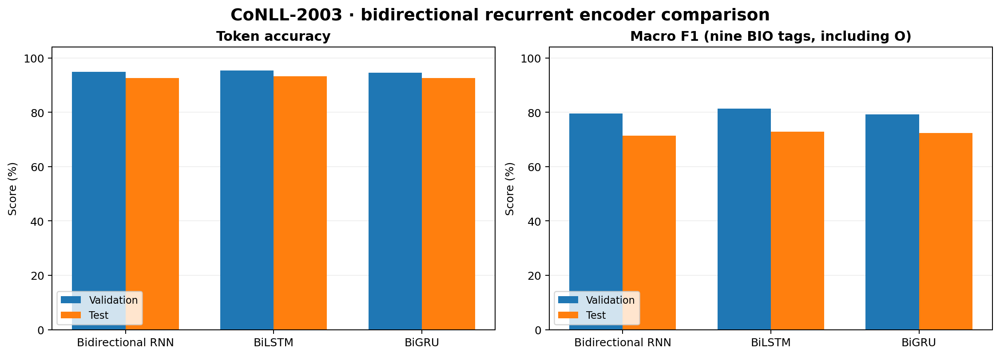
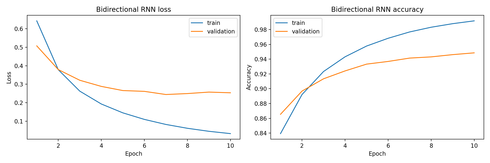
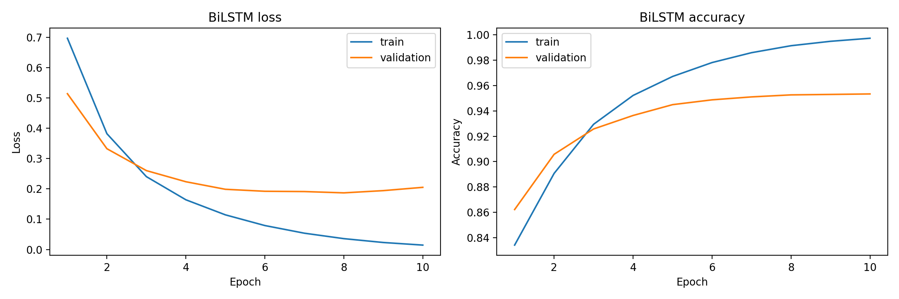
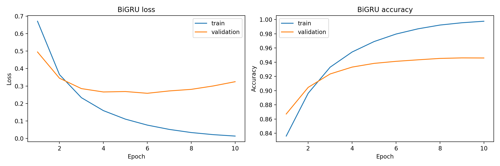

# Named Entity Recognition with Bidirectional Recurrent Encoders

**A controlled comparison of BiRNN, BiLSTM, and BiGRU sequence taggers on CoNLL-2003**

This repository investigates how the choice of recurrent encoder affects **token-level named entity recognition (NER)** when the dataset, tokenization, vocabulary, model width, optimizer, and training budget are held fixed. Three PyTorch models—**bidirectional vanilla RNN, LSTM, and GRU**—are trained on the same English CoNLL-2003 splits. The project includes configurable experiments, best-validation checkpoints, training curves, and per-tag precision/recall/F1 reports.

> **Scope.** This is an experimental comparison of established recurrent architectures, not a new NER architecture. The reported F1 scores are computed **per token** with scikit-learn, **not** the entity-span F1 used for the official CoNLL benchmark. No transformer, CRF decoder, or pretrained word embeddings are used.

## At a glance

- **Task:** supervised NER with nine BIO labels (outside plus beginning/inside tags for PER, ORG, LOC, and MISC).
- **Data:** CoNLL-2003 English; 14,041 training / 3,250 validation / 3,453 test sentences.
- **Comparison:** three single-layer bidirectional encoders under a common training configuration.
- **Best test result:** **BiLSTM — 93.22% token accuracy and 72.78% macro token-level F1**.
- **Reproducibility:** random seed, YAML configuration, saved model state dictionaries, loss/accuracy curves, and complete classification reports are included.

## Research question

**Under an otherwise matched lightweight sequence-tagging setup, how do vanilla recurrent, LSTM, and GRU encoders differ in predictive performance and their treatment of rare entity tags?**

The comparison isolates the *recurrent cell type* as the primary experimental variable. It does not control for the different parameter counts of the cells, and it is a single-seed experiment rather than a statistically replicated study.

## Results

### Quantitative comparison

The following metrics were extracted from the provided `outputs/reports/*_classification_report.txt` files. **All numbers are percentages.** Macro F1 is averaged across the **nine BIO tags, including `O`**; it is not span-level NER F1.

| Encoder | Validation accuracy ↑ | Validation macro F1 ↑ | Test accuracy ↑ | Test macro F1 ↑ | Parameters |
|:--|--:|--:|--:|--:|--:|
| Bidirectional RNN | 94.85 | 79.55 | 92.66 | 71.42 | 1,529,929 |
| **BiLSTM** | **95.34** | **81.29** | **93.22** | **72.78** | 1,579,849 |
| BiGRU | 94.61 | 79.21 | 92.56 | 72.33 | 1,563,209 |



**Interpretation.** BiLSTM has the highest reported validation and test token accuracy and macro F1. Relative to the vanilla RNN, its test macro F1 is higher by **1.36 percentage points**. BiGRU is competitive, trailing BiLSTM by **0.45 points** of test macro F1. These differences describe this specific run; they should not be interpreted as statistically significant without multiple seeds.

### Per-tag behavior on the test set

| Tag | RNN F1 | LSTM F1 | GRU F1 |
|:--|--:|--:|--:|
| `O` | 96.75 | **97.08** | 96.50 |
| `B-PER` | 69.66 | **75.26** | 65.03 |
| `I-PER` | 68.84 | **76.74** | 66.45 |
| `B-ORG` | 67.09 | 68.10 | **69.42** |
| `I-ORG` | 66.08 | 70.09 | **70.82** |
| `B-LOC` | 79.86 | **80.39** | 79.66 |
| `I-LOC` | 63.98 | 64.97 | **72.10** |
| `B-MISC` | 68.57 | 68.89 | **69.80** |
| `I-MISC` | **61.96** | 53.53 | 61.18 |

The best aggregate model is **not** uniformly best across tags: LSTM is strongest for the person tags in this run, while GRU has the highest F1 for several organization, location-inside, and miscellaneous-begin tags. The relatively weak `I-MISC` and `I-LOC` scores emphasize why inspecting individual labels is more informative than accuracy alone.

**Class imbalance matters.** The `O` tag accounts for **38,323 of 46,435 test tokens (82.53%)**. This large majority class makes token accuracy easier to inflate than exact entity extraction quality; the per-class and macro metrics are therefore central to interpreting these results.

### Learning dynamics

The plots below are the **original experiment artifacts**: training and validation loss (left) and token accuracy (right), over the configured ten epochs.

| Bidirectional RNN | BiLSTM |
|:--:|:--:|
|  |  |

**BiGRU**



For all models, training loss continues downward after validation loss begins to flatten or rise, suggesting an emerging generalization gap during the ten-epoch runs. Checkpoints are selected by **validation token accuracy**, not validation loss or entity-level F1; the last epoch is not necessarily the selected checkpoint.

## Dataset and label representation

The project uses the [Hugging Face `eriktks/conll2003` dataset](https://huggingface.co/datasets/eriktks/conll2003), with sentence-level token sequences and accompanying integer NER labels. The English benchmark derives from the [CoNLL-2003 shared task](https://aclanthology.org/W03-0419/).

| Split | Sentences | Usage |
|:--|--:|:--|
| Train | 14,041 | Vocabulary construction and gradient updates |
| Validation | 3,250 | Model selection and diagnostics |
| Test | 3,453 | Final evaluation of selected checkpoints |

The nine tags follow BIO/IOB2 notation: `O`, `B-PER`, `I-PER`, `B-ORG`, `I-ORG`, `B-LOC`, `I-LOC`, `B-MISC`, `I-MISC`. The four entity categories are **person**, **organization**, **location**, and **miscellaneous**. Although the dataset also includes part-of-speech and chunk labels, **this implementation trains only on `tokens` and `ner_tags`**.

**Input processing:**

1. Build a token vocabulary **only from training sentences**, ordered by frequency (then alphabetically) with a minimum frequency cutoff of 1.
2. Reserve `<pad>`, `<unk>`, `<s>`, and `</s>` vocabulary entries (IDs 0–3). Only padding and unknown-token fallback are used by the dataset loader; the start/end tokens are *not* added to sequences.
3. Map out-of-vocabulary tokens to `<unk>`. The checkpoints have a vocabulary/embedding table of **23,627 tokens × 64 dimensions**.
4. Pad sequences dynamically within each mini-batch, padding input token IDs with 0 and label IDs with `-100`.
5. Use packed sequences so the recurrent layers do not process padding as ordinary tokens. Exclude padded labels from loss and reported metrics.

## Architecture

Each model differs **only in the recurrent cell family**; the surrounding embedding and prediction heads are identical.

```text
Token IDs [batch, length]
          |
          v
Trainable embedding (64 dimensions)
          |
          v
Bidirectional RNN / LSTM / GRU
  1 layer, 64 hidden units per direction
          |
          v
Concatenated forward/backward states (128 dimensions)
          |
          v
Linear classifier (128 -> 9)
          |
          v
Per-token logits [batch, length, 9]
          |
          v
Argmax -> predicted BIO tags
```

For a token sequence of length `T`, embeddings and forward/backward hidden states are represented as:

```math
e_t = E[x_t] \in \mathbb{R}^{64},\qquad
\overrightarrow{h}_t,\overleftarrow{h}_t \in \mathbb{R}^{64}.
```

The two contextual directions are concatenated before classification:

```math
h_t = [\overrightarrow{h}_t;\overleftarrow{h}_t] \in \mathbb{R}^{128},\qquad
z_t = W h_t + b \in \mathbb{R}^{9},\qquad
\hat{y}_t = \arg\max_{k\in\{1,\ldots,9\}} z_{t,k}.
```

For the **vanilla RNN**, each directional recurrence uses a tanh transition:

```math
h_t = \tanh(W_x e_t + W_h h_{t-1} + b).
```

**LSTM** introduces input, forget, and output gates and a cell state to regulate information flow; **GRU** uses reset and update gates without a separate cell state. The implementation uses the corresponding built-in PyTorch modules (`nn.RNN`, `nn.LSTM`, `nn.GRU`), not custom cell implementations. All embeddings are learned from scratch.

## Optimization and evaluation

| Setting | Value |
|:--|:--|
| Embedding width | 64 |
| Recurrent hidden width | 64 **per direction** |
| Recurrent layers | 1 |
| Bidirectional | Yes |
| Batch size | 32 |
| Epochs | 10 |
| Optimizer | AdamW |
| Learning rate | 0.001 |
| Weight decay | 0.0 |
| Gradient clipping | Maximum global L2 norm 5.0 |
| Loss | Cross-entropy with padded labels ignored |
| Checkpoint criterion | Highest validation **token accuracy** |
| Configured random seed | 42 |
| Compute | CUDA if available; otherwise CPU |

For valid (non-padding) token positions, the training loss is the mean negative log-likelihood of the gold label:

```math
\mathcal{L} = -\frac{1}{N}\sum_{i=1}^{B}\sum_{t=1}^{T_i}
\log\left(
\frac{\exp(z_{i,t,y_{i,t}})}{\sum_{k=1}^{9}\exp(z_{i,t,k})}
\right),\qquad
N=\sum_{i=1}^{B}T_i.
```

All padded positions (marked `-100`) are omitted from both the loss and the token accuracy:

```math
\mathrm{Accuracy}_{\mathrm{token}}
=\frac{\sum_{i=1}^{B}\sum_{t=1}^{T_i}
\mathbf{1}[\hat y_{i,t}=y_{i,t}]}{\sum_{i=1}^{B}T_i}.
```

Per-tag precision, recall, and F1 are computed with `sklearn.metrics.classification_report`, with macro F1 defined as the mean across all nine tags:

```math
P_c=\frac{TP_c}{TP_c+FP_c},\qquad
R_c=\frac{TP_c}{TP_c+FN_c},\qquad
F1_c=\frac{2P_cR_c}{P_c+R_c},\qquad
F1_{\mathrm{macro}}=\frac{1}{9}\sum_{c=1}^{9}F1_c.
```

Zero-division cases are reported as zero in the implementation.

## Reproduce the experiments

### 1. Install

Use a Python environment compatible with PyTorch and the other dependencies; the project requirements intentionally leave most library versions unpinned.

```bash
git clone https://github.com/<YOUR_USERNAME>/conll2003-recurrent-ner-study.git
cd conll2003-recurrent-ner-study
python -m venv .venv
source .venv/bin/activate   # Windows PowerShell: .venv\Scripts\Activate.ps1
pip install -r requirements.txt
```

### 2. Train and evaluate

```bash
python scripts/main.py
```

This loads the dataset, creates the training-only vocabulary and dataloaders, trains **all three encoders**, saves the highest-validation-accuracy checkpoint for each model, and generates train/validation learning curves and validation/test classification reports. The script also prints the dataset features and example batch shapes.

Override the training duration:

```bash
python scripts/main.py --epochs 5
```

To run a subset of architectures, change `experiments` in `config/config.yaml`, e.g. `experiments: [lstm]`. Dataset settings, embedding size, hidden size, batch size, device, and optimizer settings are in the same file.

**Dataset compatibility:** the loader first requests `eriktks/conll2003` at the `convert/parquet` revision, because its default branch uses a legacy dataset-loading script. The code implements a fallback path. Availability of these revisions or mirrors is external to this repository, so rerunning requires internet access and a working compatible dataset source.

### 3. Locate outputs

```text
.
├── config/
│   └── config.yaml                # Dataset, architecture, and training settings
├── data/
│   └── data_loader.py             # Vocabulary, dataset adapter, dynamic padding
├── models/
│   ├── model.py                   # Shared bidirectional encoder tagger
│   └── saved_models/
│       ├── rnn_best.pt
│       ├── lstm_best.pt
│       └── gru_best.pt            # Best checkpoints by validation token accuracy
├── scripts/
│   ├── main.py                    # End-to-end experiment entry point
│   ├── train.py                   # Optimization and checkpoint selection
│   └── evaluate.py                # Report generation
├── utils/
│   ├── metrics.py                 # Masked metrics and sklearn reports
│   └── visualization.py          # Learning-curve plotting
├── outputs/
│   ├── plots/                     # Three original loss/accuracy figures
│   └── reports/                   # Six validation/test text reports
├── docs/
│   └── assets/model_comparison.png
├── requirements.txt
└── README.md
```

The `.pt` files contain **model weights only**. To reproduce their token-ID mapping, reconstruct the training vocabulary using the same dataset content and deterministic vocabulary-building procedure. They are not self-contained, ready-to-deploy text taggers.

## Limitations and next experiments

- **Token-level F1 is not CoNLL entity F1.** `classification_report` scores each BIO label independently, including `O`; it does not enforce correct entity boundaries or evaluate complete spans. For a benchmark-comparable result, add IOB2-aware **entity-level micro F1** with [seqeval](https://github.com/chakki-works/seqeval) or an equivalent CoNLL evaluator.
- **Only one random seed.** Runs were configured with seed 42, but backend determinism was not forced and no variance or confidence interval is available. Replicate across multiple seeds before making claims of architectural superiority.
- **Checkpoint selection favors token accuracy.** Given the high `O` frequency, validation entity F1 would be a more task-aligned selection metric.
- **No structured decoding.** Independent per-token argmax can produce invalid BIO transitions; a constrained decoder or CRF could address this.
- **No contextual pretrained embeddings.** The small token vocabulary and randomly initialized 64-dimensional embeddings limit generalization to unseen words, while pretrained word vectors or transformers could provide stronger baselines.
- **Observed generalization gap.** All three training curves show very low final training loss but higher validation loss. Regularization and early stopping warrant further investigation.
- **No packaged inference pipeline.** Saved weights do not include a serialized vocabulary, preprocessing metadata, or an inference API.

These are natural extensions of the existing comparison, **not experiments claimed to have been completed**.

## References

1. Erik F. Tjong Kim Sang and Fien De Meulder (2003). [*Introduction to the CoNLL-2003 Shared Task: Language-Independent Named Entity Recognition*](https://aclanthology.org/W03-0419/). CoNLL 2003.
2. [CoNLL-2003 dataset card](https://huggingface.co/datasets/eriktks/conll2003), Hugging Face Datasets.
3. Sepp Hochreiter and Jürgen Schmidhuber (1997). [*Long Short-Term Memory*](https://doi.org/10.1162/neco.1997.9.8.1735). *Neural Computation*.
4. Kyunghyun Cho et al. (2014). [*Learning Phrase Representations using RNN Encoder–Decoder for Statistical Machine Translation*](https://arxiv.org/abs/1406.1078). EMNLP 2014.
5. [PyTorch: `pack_padded_sequence`](https://docs.pytorch.org/docs/stable/generated/torch.nn.utils.rnn.pack_padded_sequence.html) and [seqeval](https://github.com/chakki-works/seqeval) documentation.

---

*The tables and figures above describe the saved results supplied with this repository; they have not been independently reproduced by rerunning training. No claim of state-of-the-art benchmark performance is made.*
